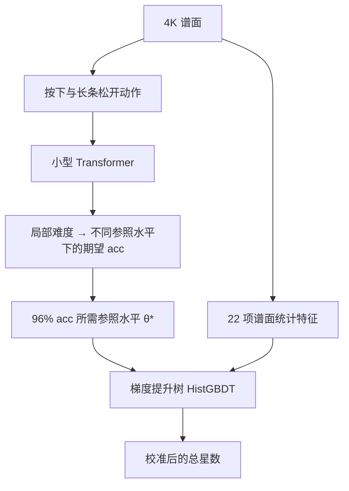

# osu!mania 4K 星数工具

在浏览器里估算 osu!mania 4K 谱面的难度，并查看谱面各段的难度起伏。
拖入 `.osu` 或 `.osz` 即可使用，无需 replay、GPU 或额外安装软件。
谱面文件在浏览器本地处理，不会上传到服务器。

**[打开在线工具](https://sky2002.github.io/osu-star-web/)** · **[反馈问题或谱面读数](https://github.com/sky2002/osu-star-web/issues/new)**

当前版本：**树星数 v1**（P1h，2026-10-14）。这是试用中的社区难度读数，不是 osu! 官方星数。

另有 **tosu 插件**（试用）：选歌时自动读出当前谱面和 Mod 的星数，见 [tosu/README.md](tosu/README.md)，安装包在 [Releases](https://github.com/sky2002/osu-star-web/releases)。插件还没在真实 tosu 里测试过。

## 怎么用

1. 打开网页，等待“模型已就绪”。首次使用需要下载模型和运行库。
2. 需要时在上方选 Mod（NoMod / HT / DT），再拖入或选择一个或多个 `.osu` / `.osz` 文件；压缩包中的 4K 难度会自动列出。
3. 查看总星数、附近段位参考谱、物件数、分段曲线和最难的一段。
4. 读数与手感差得较多时，点击“复制读数信息”，连同你的预期发到 Issues。

支持 **osu!mania 4K**，Mod 可选 **NoMod、HT（0.75 倍）、DT/NC（1.5 倍）**，谱面至少需要 20 个物件。
非 mania、非 4K 或物件太少时会显示原因。切换 Mod 后，已加入的谱面会按新倍速重新计算；算过的读数会保留，来回切换不用重算。

结果卡在谱名下面同时显示 **米段位** 和 **面段位**：把这张谱和 REFORM / LN 段位谱用同一模型、同一标准比较，显示它落在哪段及段内位置（如 “Alpha mid（11.00）”，段内方位词按与最近档位锚点的偏差划分）；不代表能通过对应段位。
米段位用总星数（96% ScoreV1）对 REFORM 1st–Eta 的 Marathon 整段读数；面段位用整谱 97% ScoreV2 读数对 LN Dan Courses v2 5th–15th 的同标准读数（4 段及以下不用，显示“LN5 以下”）。
参照读数先按段位顺序单调化，相邻两段相差不到 0.05 星时合成一档（REFORM 3rd 用同模型 3dan 谱的替代读数，2nd/3rd 可正常分开）；高于最高段显示“!17+”/“!15+”。长条占物件不到 15% 的谱面段位变灰；HT / DT 下用该倍速读数对 NoMod 段位谱。整谱 97% ScoreV2 读数总是计算（单线程多花约 3–9% 时间），不依赖实验性功能开关。

结果卡会分组显示 **REFORM 主线**和 **LN Dan Courses v2** 的附近参考谱：每组最多两张，与当前总星数相差不超过 0.5 星，使用同一版 P1h 读数。它只帮助理解这把星数尺子，不代表玩家能通过对应段位。LN 课程的计分口径与当前 96% ScoreV1 不同，部分相邻段位的模型排序也有倒挂，请结合题型与手感判断；没有接近的参考谱时会直接说明。

Mod 按钮下面有一个 **实验性功能** 开关（默认关闭，浏览器会记住）。打开后结果卡多出下面几块，它们都是约定换算，不影响总星数；开关打开时，已经算好的谱会补算一次分项。

结果卡的 **达成水平** 表（实验性功能）：打到 90% / 93% / 96% / 98% 或自己输入的 acc（85–99.5%）平均需要多强，用总星数同一刻度表示，96% 一行就是总星数。
它只按总星数换算台阶（难谱上强弱玩家差距更大，台阶更小），不看键型；每行标“观测”（有人群成绩直接支撑）或“外推”。
反过来也能读：在这张谱上打出 93%，大致相当于表中 93% 一行的水平；单局波动大（标准差约 0.5–0.8 星），acc ≥99% 或 <85% 时不可靠。
口径仍是 ScoreV1；长条较多的谱会提示它不是 LN 段位常用的 97% ScoreV2。

实验性功能打开时，总星数旁边多一个 **LN 口径** 星数：整谱按 97% ScoreV2（LN 段位体系的计分口径，OD 用谱面文件）读出，换算同下，仅供参考；它通常比总星数高 0.4–0.8 星。

结果卡的 **分项（约定换算）**（实验性功能），四行（LN 口径、米、面、OD）：**米**（只看单点，96% ScoreV1 所需水平）、**面**（只看长条头尾，97% ScoreV2 所需水平）、**OD8 / OD9 口径**（按固定 OD 重判整谱；总星数 ≥6.3 星时用 OD9）。
换算是 总星数 + 1.772 × (分项 θ* − 整谱 θ*)，系数借自 DT 规则，属于约定；单点或长条不足时显示“米太少”“长条太少”。
面分项在带零星长条的米图上会明显高于总星数，只适合在长条为主的谱之间比较。OD 口径对 LN 长谱会使计算时间接近翻倍。

**总星数与分段曲线使用不同刻度。** 总星数经过树模型校准；分段曲线保留早期的参照水平刻度，用于看起伏。
例如，总星数 7.0、某段曲线 6.5，不能直接解释为“这一段比整谱低 0.5 星”。

## 模型如何计算

模型先估计“在这张谱上打到 96% acc，需要多高的参照水平”，再结合谱面统计特征，校准成总星数。
这里的 acc 使用 **stable ScoreV1** 判定口径和谱面文件中的 OD，是模型的期望值，不保证某个玩家一定打到这个成绩。



- **动作编码**：把音符按下和长条松开拆成动作，每个动作用 17 维特征描述。
- **Transformer**：2 层、128 维、4 个注意力头，使用 RoPE 位置编码，总前瞻范围最多 2 秒，输出按下与松开的局部难度。
- **准确率换算**：在一组公共参照水平上，用 Student-t 分布描述打击误差，同时计入漏按，再按判定窗口换算期望 acc，求出达到 96% 的水平 θ*。
- **总星数校准**：将 θ* 与密度、长条比例、和弦、jack、时长等 22 项统计特征一起输入 HistGBDT，再映射到星数刻度。
- **HT / DT**：与训练时 DT 样本的算法相同。所有时间除以倍速（动作编码与 22 项特征都按变速后的实际时间计算，OD 仍取谱面文件值）；判定按 stable 规则在谱面时间里进行，打击误差的位置与散度乘以倍速，判定窗口用 stable 的 DT / HT 整数窗口。

网页推理不需要任何玩家的个人参数。Transformer 通过 ONNX Runtime Web 的 WebAssembly 后端运行，其余步骤由 JavaScript 完成；计算放在 Web Worker 中，长谱会使用辅助 worker 加速。

## 已知限制

- **高难谱**：超出训练覆盖范围时仍会给出读数，但标记“不可靠”；这一段的验证还不充分。
- **长条与 jack**：部分 LN 段位谱与 jack 谱的排序存在已知偏差；按 acc 定义的难度也可能与段位手感不同。
- **SV / storyboard**：明显变速或带 storyboard 的谱未纳入训练，其难度效果尚未验证，页面会提示读数不可靠。
- **Mod**：只支持 HT（0.75 倍）和 DT/NC（1.5 倍），不支持其他倍速和 HR、EZ、HD 等 mod。
  - DT：树模型训练时用过官方成绩库里同一批谱的 DT 成绩，检验口径与 NoMod 相同；读数高于约 8.5 星的部分主要来自外推答案，可信度较低。
  - HT：官方成绩库中的 HT 成绩多为练习或试玩，不可靠，没有用于训练或检验；HT 读数只是同一方法在放慢谱面上的结果，页面会提示未经检验。HT 下判定“超出范围”时沿用 NoMod 排名谱的范围。
  - 少数谱的倍速读数不单调：极简单的谱 HT 可能读得比 NoMod 略高，最难的 Eta 类谱 DT 可能读得比 NoMod 略低（树模型在顶端封顶）。
- **浏览器**：需要支持模块 Worker 和 WebAssembly SIMD 的现代浏览器。

遇到“不可靠”提示时，建议把读数作为参考，并结合实际手感判断。

## 本地预览

需要 Node.js，在仓库根目录运行：

```sh
node tools/serve.mjs 8790
```

打开 [http://127.0.0.1:8790/](http://127.0.0.1:8790/)，结束时按 `Ctrl+C`。
预览不需要先安装 npm 依赖；网页所需运行库已放在 `docs/vendor/`。
请通过 HTTP 打开，直接双击 `index.html` 无法加载 worker 和模型。

## 开发与验证

- `docs/`：静态网页，也是 GitHub Pages 的发布目录。
- `docs/js/`：谱面解析、动作编码、推理、特征计算和页面逻辑。
- `docs/model/`：Transformer 权重、参照水平参数、树模型和适用范围统计。
- `tests/`：与 Python 参考实现的数值一致性检查。

已有样本检查验证了浏览器移植结果与 Python 参考读数的一致性；这不等于模型对所有谱面的难度判断都准确。
`npm run test:references` 可独立检查段位参考数据与匹配逻辑，无需安装依赖或提供谱面文件。
`npm run test:ladder` 可独立检查达成水平表与 Python 参照实现（研究仓库 `analysis/acc-ladder-r1/ladder_ref.py`）逐位一致，同样无需谱面文件。
`npm test` **不是独立可运行的公开测试集**：它需要研究项目中未随本仓库发布的谱面文件，并通过 `OSU_DIFF_ROOT` 指定位置。
具备这些文件时，可在 PowerShell 中运行：

```powershell
npm install
$env:OSU_DIFF_ROOT = '你的研究项目根目录'
node tests/compare.mjs --limit 24 --tol 0.01
node tests/compare_rates.mjs --limit 24 --tol 0.01   # HT / DT，对照 analysis/web-rate-r1/score_rate.py
```

检查结果写入 `tests/out/`。普通使用者直接打开在线工具或本地预览即可。
