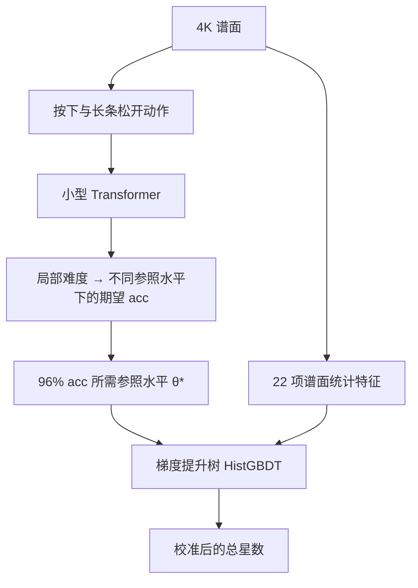

# osu!mania 4K 星数工具

在浏览器里估算 osu!mania 4K 谱面的难度，并查看谱面各段的难度起伏。
拖入 `.osu` 或 `.osz` 即可使用，无需 replay、GPU 或额外安装软件。
谱面文件在浏览器本地处理，不会上传到服务器。

**[打开在线工具](https://sky2002.github.io/osu-star-web/)** · **[反馈问题或谱面读数](https://github.com/sky2002/osu-star-web/issues/new)**

当前版本：**树星数 v1**（P1h，2026-10-14）。这是试用中的社区难度读数，不是 osu! 官方星数。

另有 **tosu 插件**（试用）：选歌时自动读出当前谱面和 Mod 的星数，见 [tosu/README.md](tosu/README.md)，安装包在 [Releases](https://github.com/sky2002/osu-star-web/releases)。插件还没在真实 tosu 里测试过。

## 怎么用

1. 打开网页，等待“模型已就绪”。首次使用需要下载模型和运行库。
2. 需要时在上方选 Mod（NoMod / HT / DT），再拖入或选择一个或多个 `.osu` / `.osz` 文件；压缩包中的 4K 难度会自动列出。
3. 查看总星数、附近段位参考谱、物件数、分段曲线和最难的一段。
4. 读数与手感差得较多时，点击“复制读数信息”，连同你的预期发到 Issues。

支持 **osu!mania 4K**，Mod 可选 **NoMod、HT（0.75 倍）、DT/NC（1.5 倍）**，谱面至少需要 20 个物件。
非 mania、非 4K 或物件太少时会显示原因。切换 Mod 后，已加入的谱面会按新倍速重新计算；算过的读数会保留，来回切换不用重算。

结果卡在谱名下面同时显示 **米段位** 和 **面段位**：把这张谱和 REFORM / LN 段位谱用同一模型、同一标准比较，看它排在哪两段之间（如“7th–8th 之间（偏 8th）”）；不代表能通过对应段位。
米段位用总星数（96% ScoreV1）对 REFORM 1st–Eta 的 Marathon 整段读数；面段位用整谱 97% ScoreV2 读数对 LN Dan Courses v2 6th–15th 的同标准读数（5 段及以下不用，显示“LN 6 段以下”）。
参照读数先按段位顺序单调化，相邻两段相差不到 0.05 星时合成一档；高于最高段标“外推”。长条占物件不到 15% 的谱面段位变灰；HT / DT 下用该倍速读数对 NoMod 段位谱。整谱 97% ScoreV2 读数总是计算（单线程多花约 3–9% 时间），不依赖实验性功能开关。
米段位下面另有一行 **米段位（按单曲）**：同一个总星数对 REFORM 官方单曲（60 首，每段 2–6 首，`docs/data/dan-references.json` 的 `reformSingles`，P1h、谱面文件 OD）按段平均的读数，读法同上；主读数仍是整段。误差约 ±0.15 段，Eta 没有单曲，高于 Zeta 为外推。依据研究仓库 `analysis/bias-multidim-r1/A`（实验 A）。

结果卡会分组显示 **REFORM 主线**和 **LN Dan Courses v2** 的附近参考谱：每组最多两张，与当前总星数相差不超过 0.5 星，使用同一版 P1h 读数。它只帮助理解这把星数尺子，不代表玩家能通过对应段位。LN 课程的计分口径与当前 96% ScoreV1 不同，部分相邻段位的模型排序也有倒挂，请结合题型与手感判断；没有接近的参考谱时会直接说明。

结果卡还有一块 **键型分项（测试版）**：叠（jack）★、乱★、切★（双押切、三押切）、单手交互★（以前叫切），以及“失分构成”（叠、乱/切（以前叫速度，括号里再分乱、切）、长条、锁列、其他各占几成；单手交互和节奏不规则与这些类别重叠，单独列出；节奏不规则较多时标“多级乱较多”）。乱、切按社区的习惯整段归类：每一行看前后各 1 秒内的行，分成叠段、乱段、双押切段、三押切段或不归段（研究仓库 `analysis/pattern-items-community-r2/pc_sections.py`，方案 `docs/pattern-items-community-r2-plan-2026-10-25.md` 第一步）；乱★ = 乱段里的快键，切★ = 双押切段、三押切段里的快键，叠段里和不归段的快键只算进乱/切合计。叠的定义不变。键型名称按中文 4K 社区的说法（研究仓库 `docs/pattern-glossary-2026-10-25.md`）。
分项★ 的意思是：平均要多强的玩家，才能在这张谱的【这类键】上打到 96%（和总星数同一刻度），不是加起来等于总星数。
它来自研究仓库的“路线 A”（`docs/pattern-items-route-a-final-2026-10-19.md`）：用规则给每个音符分类，再用同一个 s29 模型逐音符的失分算分项，配置 C2（jack 校准、爆发 / 切校准、卡手失分 ×1.27）；总星数不变。
路线 A 的叠、乱/切合计、单手交互三个分项在 62 组群友和 8 名新玩家的“同人两张谱谁打得更差”检验上都比只看总星数准；乱★、切★ 在群友数据上检验过。
**只在 NoMod、谱面文件 OD、非变速谱上给出**；HT / DT、自定义 OD 和变速谱下只显示一句说明。某类键少于 50 个或不到 5% 时不给这一项的星数。长条★ 还没定，暂不显示。
失分构成下面会出 **“X 苦手要小心”** 提示：叠 ≥45%、乱/切 ≥90%、长条 ≥30%（按卡片上显示的整数百分比）。叠在总星数 3–7 星内另给“大约觉得难 0.722 × 占比 星”（四舍五入到 0.1，群体平均）；乱/切、长条只给文字。依据研究仓库 `data/loss-share-hint-r1/RESULTS.md`，规则常量在 `docs/js/ui-lib.js` 的 `PATTERN_HINTS`；每个方向读哪一项的失分占比在 `HINT_ITEM`（现在是路线 A 的叠、乱/切合计、长条）。
它和实验性功能里的米 / 面分项是两套换算，不要混着比较。计算时要多做一遍第二层：单线程实测 4 张谱多花 17–84% 时间（长条多的谱最多，长谱在网页里会分给辅助 worker）；tosu 插件不算分项。

页面最上面有 **模型** 开关（浏览器会记住，默认 P1h）：**P1h**（现行星数）、**CNN36**（测试版新星数）、**两个都看**（P1h 为主，结果卡里多一块“新星数”并排对比）。
CNN36 = P1h 同一配方的树多一列 CNN36 读数：一个直接读整张谱 10 ms 网格（四列按下 / 松开 / 按住 + OD）的小一维卷积网络，10 个模型（种子 17 / 29 × 5 折）× 原谱 / 镜像取平均（`docs/model/cnn36.onnx`，11 MB，选到时才加载），树为 20 个种子取平均（`docs/model/tree-cnn36.json`）。
依据研究仓库 `docs/cnn36-web-r1-results-2026-10-25.md`：留出排名谱的近邻谱对判对率 82.9%（P1h 80.5%），群友 replay 上两者打平；网页流水线对 Python 参照最大差 6e-5 星。
只在 NoMod 和 DT（谱面文件 OD）下给；只看 CNN36 时，米段位按 `docs/data/dan-references-cnn36.json`（同一批段位谱的 CNN36 读数）换算，键型分项、米 / 面分项等挂在总星数上的读数按同一个差平移，分段曲线不变。已算好的谱切过去只补算新星数（不重跑逐动作模型），2–3 分钟的谱单线程多约 0.8 秒。tosu 插件不算新星数。
检查：`OSU_DIFF_ROOT=<研究仓库> node tests/cnn36.mjs`（网格逐字节、ONNX 读数）和 `node tests/compare_cnn36_star.mjs`（整条流水线的新星数）。

Mod 按钮下面有一个 **实验性功能** 开关（默认关闭，浏览器会记住）。打开后结果卡多出下面几块，它们都是约定换算，不影响总星数；开关打开时，已经算好的谱会补算一次分项。

结果卡的 **达成水平** 表（实验性功能）：打到 90% / 93% / 96% / 98% 或自己设定的 acc（85–99.5%，滑条和输入框都可以调）平均需要多强，用总星数同一刻度表示，96% 一行就是总星数。
它只按总星数换算台阶（难谱上强弱玩家差距更大，台阶更小），不看键型；每行标“观测”（有人群成绩直接支撑）或“外推”。
反过来也能读：在这张谱上打出 93%，大致相当于表中 93% 一行的水平；单局波动大（标准差约 0.5–0.8 星），acc ≥99% 或 <85% 时不可靠。
口径仍是 ScoreV1；长条较多的谱会提示它不是 LN 段位常用的 97% ScoreV2。

实验性功能打开时，Mod 下面多一行 **OD**：默认“谱面文件”，选“自定义”后可拖滑条或输入 OD（0–10，一位小数），松手或停止输入后全部谱面按这个 OD 重算。它同时换掉判定窗口和模型的 OD 特征（类似 lazer Difficulty Adjust），可与 HT / DT 叠加；模型训练时只见过谱面自带的 OD，自定义 OD 的读数未经单独检验，仅供参考。结果卡与复制文字会标出“OD x（自定义；谱面 y）”；选回“谱面文件”或关掉实验性功能即回到文件 OD，算过的 OD 会记住。tosu 插件没有这个设置（插件仍跟随游戏里的 DA）。

实验性功能打开时，总星数旁边多一个 **LN 口径** 星数：整谱按 97% ScoreV2（LN 段位体系的计分口径，OD 同总星数）读出，换算同下，仅供参考；它通常比总星数高 0.4–0.8 星。

结果卡的 **分项（约定换算）**（实验性功能），四行（LN 口径、米、面、OD）：**米**（只看单点，96% ScoreV1 所需水平）、**面**（只看长条头尾，97% ScoreV2 所需水平）、**OD8 / OD9 口径**（按固定 OD 重判整谱；总星数 ≥6.3 星时用 OD9）。
换算是 总星数 + 1.772 × (分项 θ* − 整谱 θ*)，系数借自 DT 规则，属于约定；单点或长条不足时显示“米太少”“长条太少”。
面分项在带零星长条的米图上会明显高于总星数，只适合在长条为主的谱之间比较。OD 口径对 LN 长谱会使计算时间接近翻倍。

**总星数与分段曲线使用不同刻度。** 总星数经过树模型校准；分段曲线保留早期的参照水平刻度，用于看起伏。
例如，总星数 7.0、某段曲线 6.5，不能直接解释为“这一段比整谱低 0.5 星”。

## 模型如何计算

模型先估计“在这张谱上打到 96% acc，需要多高的参照水平”，再结合谱面统计特征，校准成总星数。
这里的 acc 使用 **stable ScoreV1** 判定口径和谱面文件中的 OD，是模型的期望值，不保证某个玩家一定打到这个成绩。



- **动作编码**：把音符按下和长条松开拆成动作，每个动作用 17 维特征描述。
- **Transformer**：2 层、128 维、4 个注意力头，使用 RoPE 位置编码，总前瞻范围最多 2 秒，输出按下与松开的局部难度。
- **准确率换算**：在一组公共参照水平上，用 Student-t 分布描述打击误差，同时计入漏按，再按判定窗口换算期望 acc，求出达到 96% 的水平 θ*。
- **总星数校准**：将 θ* 与密度、长条比例、和弦、jack、时长等 22 项统计特征一起输入 HistGBDT，再映射到星数刻度。
- **HT / DT**：与训练时 DT 样本的算法相同。所有时间除以倍速（动作编码与 22 项特征都按变速后的实际时间计算，OD 仍取谱面文件值）；判定按 stable 规则在谱面时间里进行，打击误差的位置与散度乘以倍速，判定窗口用 stable 的 DT / HT 整数窗口。

网页推理不需要任何玩家的个人参数。Transformer 通过 ONNX Runtime Web 的 WebAssembly 后端运行，其余步骤由 JavaScript 完成；计算放在 Web Worker 中，长谱会使用辅助 worker 加速。

## 已知限制

- **高难谱**：超出训练覆盖范围时仍会给出读数，但标记“不可靠”；这一段的验证还不充分。
- **长条与 jack**：部分 LN 段位谱与 jack 谱的排序存在已知偏差；按 acc 定义的难度也可能与段位手感不同。
- **SV / storyboard**：明显变速或带 storyboard 的谱未纳入训练，其难度效果尚未验证，页面会提示读数不可靠。
- **Mod**：只支持 HT（0.75 倍）和 DT/NC（1.5 倍），不支持其他倍速和 HR、EZ、HD 等 mod。
  - DT：树模型训练时用过官方成绩库里同一批谱的 DT 成绩，检验口径与 NoMod 相同；读数高于约 8.5 星的部分主要来自外推答案，可信度较低。
  - HT：官方成绩库中的 HT 成绩多为练习或试玩，不可靠，没有用于训练或检验；HT 读数只是同一方法在放慢谱面上的结果，页面会提示未经检验。HT 下判定“超出范围”时沿用 NoMod 排名谱的范围。
  - 少数谱的倍速读数不单调：极简单的谱 HT 可能读得比 NoMod 略高，最难的 Eta 类谱 DT 可能读得比 NoMod 略低（树模型在顶端封顶）。
- **浏览器**：需要支持模块 Worker 和 WebAssembly SIMD 的现代浏览器。

遇到“不可靠”提示时，建议把读数作为参考，并结合实际手感判断。

## 本地预览

需要 Node.js，在仓库根目录运行：

```sh
node tools/serve.mjs 8790
```

打开 [http://127.0.0.1:8790/](http://127.0.0.1:8790/)，结束时按 `Ctrl+C`。
预览不需要先安装 npm 依赖；网页所需运行库已放在 `docs/vendor/`。
请通过 HTTP 打开，直接双击 `index.html` 无法加载 worker 和模型。

## 开发与验证

- `docs/`：静态网页，也是 GitHub Pages 的发布目录。
- `docs/js/`：谱面解析、动作编码、推理、特征计算和页面逻辑。
- `docs/model/`：Transformer 权重、参照水平参数、树模型和适用范围统计。
- `tests/`：与 Python 参考实现的数值一致性检查。

已有样本检查验证了浏览器移植结果与 Python 参考读数的一致性；这不等于模型对所有谱面的难度判断都准确。
`npm run test:references` 可独立检查段位参考数据与匹配逻辑，无需安装依赖或提供谱面文件。
`npm run test:ladder` 可独立检查达成水平表与 Python 参照实现（研究仓库 `analysis/acc-ladder-r1/ladder_ref.py`）逐位一致，同样无需谱面文件。
`npm run test:dan` 检查米 / 面段位与“米段位（按单曲）”一行（单曲尺子对研究仓库 `analysis/bias-multidim-r1/A` 的 Python 结果差 ≤1e-6）；
`npm run test:hints` 检查键型分项的“苦手要小心”提示，并在 442 张参照谱上对照独立的 Python 规则（`tools/hint-reference.py` 生成 `tests/fixtures/reference-hints.json`）。两者都无需谱面文件。
`npm test` **不是独立可运行的公开测试集**：它需要研究项目中未随本仓库发布的谱面文件，并通过 `OSU_DIFF_ROOT` 指定位置。
具备这些文件时，可在 PowerShell 中运行：

```powershell
npm install
$env:OSU_DIFF_ROOT = '你的研究项目根目录'
node tests/compare.mjs --limit 24 --tol 0.01
node tests/compare_rates.mjs --limit 24 --tol 0.01   # HT / DT，对照 analysis/web-rate-r1/score_rate.py
```

键型分项（测试版）对照研究仓库 `analysis/pattern-items-community-r2/wi_ref_r2.py` 的 Python 参考（`data/web-items-r2`：路线 A 各项加 luan_s / qie_s；先在研究仓库运行 `wi_ref_r2.py run`；`--ref web-items-r1` 只比路线 A 各项；layers 模式的逐层数据来自 `analysis/web-items-r1/wi_ref.py dump`）：

```powershell
node tests/compare_items.mjs --mode e2e      # 整条网页流水线（含 ONNX 编码器）对 Python
node tests/compare_items.mjs --mode inject   # 注入 Python 编码器输出，只比编码器之后
node tests/compare_items.mjs --mode layers   # 逐层：sigma / 漏按率、逐动作得分、从 Python 得分出发的读数
```

e2e 与 inject 两种模式也会核对“苦手要小心”提示（出现与否、百分比、叠的星数）是否与 `tests/fixtures/reference-hints.json` 一致。

检查结果写入 `tests/out/`。普通使用者直接打开在线工具或本地预览即可。
